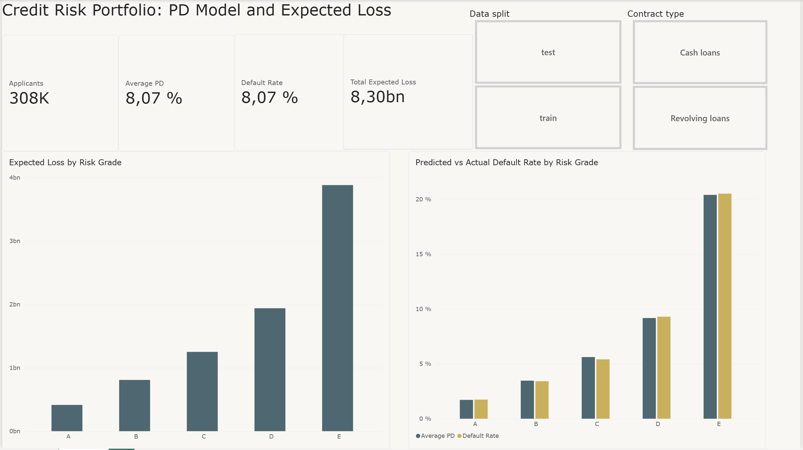

# Credit Risk Analysis and Default Prediction

**SQL (DuckDB), Python (scikit-learn) and Power BI on 307,511 loan applications**

A credit risk project on the Home Credit Default Risk dataset: from understanding the data, to finding what predicts default, to a calibrated probability of default (PD) model and an Expected Loss dashboard.

## Results at a glance

- **PD model:** logistic regression with a test **AUC of 0.748 (Gini 0.50)**, about 60% stronger than the best single feature (Gini 0.31).
- **Well calibrated:** predicted and actual default rates differ by at most about half a percentage point across PD deciles.
- **Risk is concentrated:** the riskiest 20% of applicants (grade E) carry **47% of total expected loss**.
- **Strongest behavioural signal:** applicants who missed a previous Home Credit instalment default at **18.1%**, 2.7 times the rate of those who always paid on time.

## Business question

A lender has to decide whom to lend to, how much and at what price. This project estimates each applicant's probability of default and turns it into **Expected Loss = PD × EAD × LGD**, showing where the portfolio's risk sits.

## Data

[Home Credit Default Risk](https://www.kaggle.com/c/home-credit-default-risk) (Kaggle). Four of the eight tables are used:

| Table | Grain | Rows |
|---|---|---|
| `application_train` | One row per applicant | 307,511 |
| `bureau` | One row per loan at another lender | 1,716,428 |
| `previous_application` | One row per earlier Home Credit application | 1,670,214 |
| `installments_payments` | One row per payment on previous Home Credit loans | 13,605,401 |

The data is not included in this repository. Download it from Kaggle and place the CSV files in `data/raw/`.

## Project structure

| Notebook | Purpose |
|---|---|
| `01_application_train` to `04_previous_application` | Data understanding: grain, real rows, types, missing data and anomalies for each table |
| `05_exploration` | Seven business questions on what predicts default |
| `06_feature_engineering` | One modelling table, one row per applicant |
| `07_modelling` | PD model, evaluation, Expected Loss by risk grade |
| `credit_risk_dashboard.pbix` | Power BI dashboard |

## Key findings from exploration

| Signal | Riskiest group | Default rate | Comparison group | Default rate |
|---|---|---|---|---|
| External score (`EXT_SOURCE_2`) | Lowest 10% | 18.35% | Highest 10% | 2.97% |
| Home Credit payment history | Missed an instalment | 18.12% | Always on time | 6.79% |
| Previous refusals | Refused 2+ times | 11.61% | Never refused | 7.07% |
| Bureau history | Has bad loans | 10.26% | No recorded problems | 7.00% |
| Age | 20 to 29 | 11.44% | 60 to 69 | 4.92% |

## Data quality issues handled

- `DAYS_EMPLOYED = 365243`, a placeholder for pensioners and unemployed applicants, replaced with NULL plus a "not employed" flag
- Split payments and duplicated schedule-version rows in `installments_payments`, aggregated to instalment level before customer level to avoid double counting
- Missed payments recorded both as NULL and as 0, treated together
- Missing values hidden as text codes (`XNA`, `XAP`) in `previous_application`
- Impossible dates and negative debt in `bureau` (under 0.5% of rows)
- Applicants with no history kept via LEFT JOINs, with coverage flags, since absence of history is itself a signal

## Assumptions and limitations

- **LGD assumed at 60%** (no recovery data in the dataset), a typical level for unsecured consumer lending
- **EAD approximated by the credit amount**, which overstates exposure for revolving loans
- Amounts are in an undisclosed currency
- Age is a sensitive attribute in lending and would need review before use in production
- `bureau_balance`, `POS_CASH_balance` and `credit_card_balance` are not yet used

## Tools

DuckDB (SQL), Python (pandas, scikit-learn), Power BI